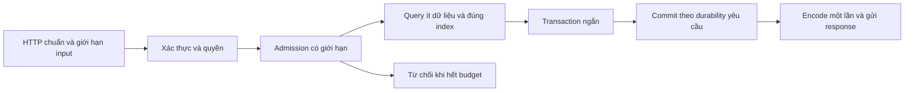

# TypeScript/Bun và Go: học tối ưu từ $12 Server Challenge để dùng cho service thật

Ngày đối chiếu: **19/10/2026**. Tài liệu này là điểm đọc chính; mã, finding và phép thử nằm trong ba phụ lục liên kết bên dưới.

## 1. Kết luận cho quyết định kỹ thuật

**Có nhiều kỹ thuật dùng được trong production. Không cần đi đến mức tự viết HTTP parser, tự quản socket hay đổi toàn bộ hệ thống sang Rust.** Phần đáng đầu tư nhất là giảm số việc trên mỗi request: query ít dữ liệu hơn, bỏ query lặp, giảm round trip tới DB/service khác, tránh dựng object trung gian, quản lý pool/queue và ngăn quá tải làm sụp cả hệ thống.

Với mục tiêu chính TypeScript và Go, hướng đề xuất là:

- **TypeScript làm API nghiệp vụ là lựa chọn hợp lý** khi lợi ích hệ sinh thái/tốc độ phát triển lớn và profile cho thấy thời gian chủ yếu ở DB/network. Giữ HTTP server và validation đáng tin; chọn Node hay Bun sau khi chạy cùng ứng dụng, driver và môi trường triển khai.
- **Bun đáng thử ở một service tách biệt**, đặc biệt code TS gọn với API native phù hợp. Bun không làm synchronous DB call trở thành bất đồng bộ; query SQLite chậm vẫn chặn event loop JS.
- **Go phù hợp làm service độc lập cho đoạn nóng đã đo được**, công việc CPU, stream hoặc concurrency cần kiểm soát. Go không sửa được query sai, fan-out quá lớn hay pool DB vô hạn. Không cần tách một RPC chỉ để thay vài phép nối chuỗi; hop mạng mới có thể đắt hơn phần tiết kiệm.
- **PostgreSQL cần chiến lược khác SQLite**: tận dụng concurrency phía DB và pool có giới hạn; giảm round trip và giữ transaction ngắn. Không bê nguyên “một connection, một hàng đợi cho mọi endpoint” sang PostgreSQL.
- **Rust/C++ là bằng chứng về trần có thể đạt của một implementation chuyên biệt**, chưa phải bằng chứng nên viết lại service hiện tại. Chỉ dùng module/service native khi profile, yêu cầu latency và năng lực vận hành biện minh được.

Đây là khuyến nghị kiến trúc từ source và tài liệu chính thức, **chưa là kết quả benchmark TS/Bun/Go với PostgreSQL**. Chưa có source service production của bạn trong phạm vi này nên chưa thể nói endpoint nào của bạn chắc chắn tăng bao nhiêu phần trăm.

## 2. Đã tải gì, đọc gì, kiểm gì?

Đã clone repo [arjaythedev/twelve-dollar-server-challenge](https://github.com/arjaythedev/twelve-dollar-server-challenge), không shallow. Đã fetch **124 PR head** mà remote công bố, và API GitHub trả cùng **124 PR** ở thời điểm lấy. Source của các đầu PR đã xuất ra `snapshots/pr-N/`.

Máy đếm được **120 tên thư mục submission, 122 phiên bản nội dung khác nhau** trên các snapshot. Một thư mục Python baseline xuất hiện trong nhiều PR không được tính là hàng trăm implementation độc lập. Xem [danh mục đầy đủ](reports/SOURCE-CATALOG.md), [manifest SHA](evidence/pr-manifest.json) và [metadata PR](evidence/pulls.json). “Tải toàn bộ” ở đây là repo challenge + các PR head và lịch sử reachable của chúng; không phải tải mọi fork GitHub hoặc toàn bộ source runtime Go/Bun/PostgreSQL và dependency ngoài repo.

| Phạm vi | Mức đã làm | Đọc tiếp khi cần |
|---|---|---|
| Benchmark | Đọc README, SPEC, schema, seed contract, k6 và test shell | `upstream/twelve-dollar-server-challenge/` |
| TypeScript/Bun/Node/Deno | Audit luồng các submission liên quan, cả native bridge | [TS-BUN-NODE-AUDIT.md](reports/TS-BUN-NODE-AUDIT.md) |
| Go | Audit các submission Go, tách stdlib/framework khỏi event loop/C engine | [GO-AUDIT.md](reports/GO-AUDIT.md) |
| Nhóm native/PHP | Đọc luồng chính Rust, C++, C, Zig, Fortran, PHP; C# raw Kestrel | [NATIVE-PHP-AUDIT.md](reports/NATIVE-PHP-AUDIT.md) |
| Các ngôn ngữ/bản còn lại | Đã tải và lập danh mục; **chưa audit sâu toàn bộ** | SOURCE-CATALOG.md |
| Chạy thực tế | Probe parser, JWT/bridge được ghi trong phụ lục và SQLite fixture | `scripts/`, `evidence/` |
| Production/load capacity | **Chưa chạy lại official droplet; chưa đo PostgreSQL hoặc service của bạn** | Cách đo ở mục 10 |

[Lịch sử thay đổi theo các submission trọng tâm](reports/OPTIMIZATION-HISTORY.md) giúp lần lại các bước tối ưu; phiên bản trong video chưa được pin chắc chắn.

Không gọi việc tải đủ source là đã đọc từng dòng. Không gọi probe hàm là full server integration test. Không chứng nhận tất cả 120 submissions đạt production. Audit này ưu tiên TS/Go và nhóm tối ưu sâu bạn hỏi; các giới hạn còn lại được ghi rõ thay vì bịa kết luận.

## 3. Chỉnh lại thước đo trước khi học tối ưu

Bài gốc cho phép SQLite in-process, không Redis/PostgreSQL/result cache, không đổi schema/index. Cho phép prepared statements, mmap và group commit nếu response đợi commit. Bài đo là năm endpoint feed/post/like/create/health; read feed chỉ lấy 20 bài. Seed có 50k user, 500k post và 2M like. Đây không phải social platform có ACL, tenant, upload, search, moderation, notifications và nhiều dependency.

Từ `bench/load.js`: mỗi vòng có hai read, xác suất 0,15 like và 0,02 create; thời gian nghỉ kỳ vọng 5 + 5,5 + 10 = 20,5 giây. Bỏ qua response time và các nhánh lỗi:

```text
requests/vòng = 2 + 0,15 + 0,02 = 2,17
64.000 VU → khoảng 6.775 request/s
writes/s   → khoảng 531
writes / tổng request ≈ 7,83%
```

Đây là **ước tính từ workload**, không phải số đo droplet. Response chậm làm vòng dài hơn; ramping-vus là closed loop nên offered load tự giảm khi server chậm. Token chọn theo VU modulo danh sách 20k token; 64k VU không đồng nghĩa 64k account độc lập.

`check()` trong k6 không có threshold `checks`; tiêu chí HTTP error mặc định cũng không bảo đảm đúng semantics. Ví dụ feed thiếu một trường mà status vẫn 200 không tự bị http_req_failed tính là lỗi. Golden suite có ích nhưng chỉ kiểm một tập mẫu; không thay fault injection, parser fuzzing, race test hoặc xác nhận không ghi trùng.

Các số Rust 224ms/52% CPU, C++ 910ms/68% CPU, PHP 40k VU trong tệp bạn đưa là **nguồn bài viết/video báo cáo**; chưa có lần đo độc lập trên droplet tương ứng ở đây. Không lấy README head hiện tại để xác nhận các số lịch sử đó. PR đã tiếp tục tiến hóa: Rust #19 có nhiều file thay vì chỉ một source dài; C #26 báo thử nhiều cấu hình; C++ #32 có local tests khác máy/generator/thời gian hold.

64k không phải giới hạn cố định Linux. Cần counters/log/cấu hình conntrack của **đúng lần chạy** để xác nhận. Direct descriptors vượt một số giới hạn ordinary FD không tự giải quyết conntrack hay memory socket. Tương tự một VU nhàn rỗi tiêu tốn connection state nhưng không tương đương một request đang dùng CPU.

## 4. Luồng chung thực sự làm hệ thống nhanh



Thời gian của một request có thể gồm queue/admission, auth, pool wait, DB/network round trips, lock/execute/commit, serialize và socket send. Các phần có thể chồng nhau; đừng cộng percentile của từng span để suy ra percentile tổng. Dùng trace và CPU profile để xác định phần nào chi phối.

SQLite cùng process rút ngắn đường đi: gọi hàm C thay cho gửi protocol, chờ socket và backend DB. Bản native giữ dữ liệu ở byte buffer, ít object/allocations và dùng một chủ connection. Trên một CPU với query rất ngắn, thread handoff có thể tốn hơn gọi trực tiếp. Nhưng chỉ cần một query chậm, page fault lớn hoặc checkpoint lâu, chính loop đó thành chỗ chặn tất cả request.

**Điều chuyển được sang service thật là tối ưu phần việc và quyền sở hữu dữ liệu; không phải mặc định bỏ concurrency, framework hoặc proxy.**

## 5. Đi sâu TypeScript/Bun/Node

### TypeScript, compiler và runtime là ba lớp khác nhau

TypeScript là ngôn ngữ/type tooling. “TypeScript viết bằng Go” nói đến **compiler và tooling native của Microsoft**, nhằm cải thiện typecheck/build/editor. Không có nghĩa ứng dụng TS của bạn được chạy bằng Go, tự thành Go binary hoặc request nhanh theo tỷ lệ build nhanh. Xem [thông báo Microsoft](https://devblogs.microsoft.com/typescript/typescript-native-port/).

Bun/Node mới là runtime chạy chương trình. TS type không tồn tại như validation cho JSON nhận từ internet: vẫn cần runtime schema và authorization. Bun transpile/chạy TS không thay bước typecheck trong CI. Compiler nhanh có ích cho vòng phát triển, là bài toán riêng với throughput của API.

### Hai kiểu “TS nhanh” cần phân biệt

**Đường sản phẩm:** HTTP server chuẩn → validate đúng một lần ở boundary → route/service gọn → DB client/pool → query → DTO rõ → serialize một lần. Đây là đường nên đầu tư đầu tiên.

**Đường contest:** socket bytes → parser chỉ giữ field cần → SQLite FFI/native render → bytes gửi thẳng. JavaScript có thể chỉ còn vai trò điều phối. Một entrypoint mang đuôi TS không chứng minh mọi công việc được làm bằng JS; Deno #119 thậm chí có transport Rust và render/SQLite C. Đọc chi tiết phụ lục trước khi so “TS vs Go”.

Với Bun SQLite, native database chạy nhanh nhưng query sync giữ JS thread. Với PostgreSQL client async, lúc chờ DB JS có thể xử lý request khác; CPU JSON lớn, crypto sync hoặc vòng lặp nặng vẫn chặn thread. Worker có ích cho CPU task đủ lớn; gửi qua worker cũng có chi phí copy/message và phải có queue budget.

### Những việc đáng làm trong service TS

1. Profile query chậm và pool wait trước khi đổi runtime. Một endpoint gọi DB theo từng item/fan-out vô hạn thường có dư địa lớn hơn đổi router.
2. Một connection pool lâu dài mỗi process, không tạo theo request. Tổng connections = số replica × số worker/process × max pool; phải tính cả jobs/admin và migration.
3. Query có projection, page size giới hạn, keyset pagination với cặp sort ổn định. Bỏ ORM hydration trên đường đọc nóng nếu đo thấy tốn, vẫn giữ repository/service contract dễ kiểm tra.
4. Validate payload tại ingress; giữ validation nghiệp vụ/DB constraints ở đúng lớp. Không xóa kiểm tra quyền vì payload đã có type.
5. Tránh serialize rồi parse lại cùng payload, middleware đọc body nhiều lần, log full request/response trên đường nóng. Dùng sampling và log có cấu trúc, không bỏ toàn bộ observability.
6. Theo dõi event-loop lag, GC pause, heap/RSS, socket count, pool wait và response bytes. Heap thấp nhưng socket/kernel/page cache cao vẫn có thể OOM.
7. Với Bun, kiểm compatibility thư viện/driver/TLS/shutdown/telemetry và soak test bằng đúng phiên bản pin. Chọn Bun vì số đo ứng dụng và vận hành, không vì hello-world RPS.

[Bun SQL](https://bun.com/docs/runtime/sql) cung cấp API pool/transaction và nhiều backend. Native binding giảm overhead không xóa network DB hay lock. Bun SQL transaction giữ connection riêng cho phạm vi đó; không gửi lệnh transaction qua các connection ngẫu nhiên.

### Cấu trúc tối thiểu nên giữ

```text
HTTP boundary: body/header/time limits + auth + runtime schema
  → application action: quyền + quy tắc nghiệp vụ + deadline
    → repository: query có giới hạn + transaction trên một connection
      → commit
    → DTO/response
```

Không cần hàng chục interface cho năm endpoint. Cũng không nên ghép auth, parser, SQL, retry và socket ownership thành một function khổng lồ chỉ vì benchmark có ít dòng. Xem finding từng implementation ở phụ lục TS.

## 6. Đi sâu Go

Go thường tạo binary triển khai đơn giản, có goroutine/network poller và profiling thuận tiện. Nhưng số goroutine không phải ngân sách concurrency. Nếu 50k request cùng chờ pool 20 connection mà không có deadline/admission, RAM và tail latency vẫn phình.

Bản Go đầu #18 có luồng HTTP → auth → enqueue operation → một owner SQLite gom batch → execute → commit → trả kết quả. Học được sự rõ ràng về ownership và chia chi phí transaction. Tuy nhiên các bản Go khác thay đổi cả HTTP stack và lượng C nằm bên dưới. Go gọi một C engine làm parse/SQL/JSON là cấu trúc khác với net/http + database/sql + encoding/json; không quy toàn bộ chênh lệch cho GC hay scheduler.

Hướng production:

- Bắt đầu HTTP server chuẩn, timeout/size limits, context deadline truyền tới DB và downstream. Với streaming phải đặt budget riêng, không áp cứng WriteTimeout của API ngắn cho mọi stream.
- Dùng database/sql hoặc pool PostgreSQL phù hợp, tái sử dụng pool, đọc số liệu chờ connection và giới hạn max/idle/lifetime. Mở pool lớn không tự tăng khả năng DB. [Go connection management](https://go.dev/doc/database/manage-connections).
- Query đọc nóng: scan vào struct/DTO nhỏ, tránh reflect/map dư nếu profile chứng minh. encoding/json thường đủ trước khi dùng custom writer.
- CPU profiling, allocation profile và trace trước khi thêm sync.Pool. Pool buffer cần ownership rõ; buffer đang được socket/consumer dùng không được trả về để request khác ghi đè. Đừng giữ buffer cực lớn trong pool sau burst.
- Batch theo use case như ingest/events/import, có count/bytes/deadline/queue limits; không mặc định gom tất cả thao tác của các request độc lập vào cùng transaction.
- GOMEMLIMIT phải chừa OS/native allocations/cgo/SQLite và socket memory, không đặt bằng toàn bộ container RAM. GOGC/PGO là bước sau, cần đo cùng workload thực.
- Race detector kiểm code Go nhưng không chứng nhận mọi C buffer hay unsafe pointer. Các bản low-level cần ASan/UBSan/fuzz/lifecycle tests ở phần native tương ứng.

**Điểm Go 22k trong bài cũ không đo giới hạn Go.** Nó đo một phiên bản, workload và ngưỡng connection cụ thể. Ngược lại các headline Go mới hàng trăm nghìn user cũng không đáng so nếu đã đổi nofile, core và thời gian hold. Phụ lục Go đối chiếu các điều kiện này.

## 7. Rust/C++ và PHP native: bài học nên mang về

Rust/C++ có khả năng giảm allocator/object churn, giữ spans vào input, tái sử dụng output, tận dụng native DB và batch I/O. Rust ownership giúp mô hình hóa lifetime ở phần safe; unsafe FFI/socket buffers vẫn cần chứng minh ownership riêng. C++ đạt lợi ích tương tự bằng kiểm soát thủ công và phải tự chịu trách nhiệm lifetime/bounds.

io_uring là API I/O của Linux, không phải giao thức mạng hoặc sửa kernel. Nó có thể gom submission/completions, giảm wakeups và dùng receive buffers theo nhu cầu. Không làm query PostgreSQL nhanh hơn chỉ vì app dùng API này. Native HTTP server trưởng thành đã giải quyết nhiều chi tiết mà raw parser contest phải tự lo.

PHP Swoole giữ server/app/DB/prepared statements lâu dài, C/C++ reactor xử lý mạng và extension native làm phần lớn công việc. PHP callback chỉ còn điều phối ngắn. Vì vậy PHP có thể đứng rất cao mà không có nghịch lý ngôn ngữ nào. Trong #28, chính README nói JIT gần trung tính; tốc độ đến từ đường xử lý và memory connection nhiều hơn khẩu hiệu bật JIT.

Ví dụ phản biện đáng học: C++ #9 nhỏ page cache + mmap vì profile của nó; C #26 head tắt mmap mặc định, cache lớn hơn vì đo được lợi ích khác. PHP #28 thử SQL JSON nhưng chọn dựng JSON ở PHP. **Tối ưu tốt là giả thuyết được đo, không phải checklist phải bật hết.**

## 8. Từ SQLite sang PostgreSQL: giữ nguyên lý, thay cơ chế

| Kỹ thuật | SQLite trong challenge | PostgreSQL service thực tế |
|---|---|---|
| Single owner | Tránh writer contention, call inline | Pool giới hạn; một connection chung mọi endpoint thường serialize quá mức |
| Group commit | App gom write vào một transaction | DB có group commit WAL; batch app nhằm giảm round trip/thực hiện bulk, cần giữ độc lập nghiệp vụ |
| Prepared statements | Plan + C API gọi trực tiếp | Driver/session/pool/proxy lifecycle; đo parse/plan và generic/custom plans khi cần |
| JSON tại DB | Giảm row/object/serialize boundary | Có thể giảm bytes/objects nhưng tốn CPU DB chung; đo app CPU + DB CPU + bytes + tail latency |
| mmap/cache size | PRAGMA theo process/file nóng | Không chuyển PRAGMA; xem buffers/cache hit/I/O/working set của PostgreSQL |
| EXCLUSIVE | Một process giữ file SQLite | Không biến thành exclusive lock PostgreSQL; lock table toàn cục sẽ phá concurrency |
| Checkpoint | Tác động event loop của app sync | Có tiến trình/cơ chế DB; theo dõi WAL/checkpoint/I/O riêng |
| No cache | Luật contest | Cache có thể hợp lệ nếu ACL, staleness và invalidation được thiết kế rõ |
| Bỏ proxy | Bớt overhead trên đúng một core | Giữ chức năng TLS/load balancing/rate limits; cân nhắc nơi đặt proxy và budget tổng |

PostgreSQL có WAL group commit; `commit_delay` là một knob cần bằng chứng, không nên bật mù quáng. Không dùng `synchronous_commit=off` để đạt điểm rồi gọi là cùng durability. Commit local durable và synchronous replication acknowledgement cũng là hai hợp đồng khác nhau. Xem [PostgreSQL WAL settings](https://www.postgresql.org/docs/current/runtime-config-wal.html).

### Luồng feed khi dùng PostgreSQL

Một hướng khởi đầu là lấy đúng 20 bài trước, sau đó join user và count likes theo post_id bằng index. Đừng group toàn bộ likes rồi mới LIMIT nếu plan không giảm sớm được dữ liệu.

```sql
WITH latest AS (
  SELECT id, user_id, body, created_at
  FROM posts
  ORDER BY created_at DESC, id DESC
  LIMIT 20
)
SELECT p.id, p.body, p.created_at, u.username,
       (SELECT count(*) FROM likes l WHERE l.post_id = p.id) AS like_count
FROM latest p
JOIN users u ON u.id = p.user_id
ORDER BY p.created_at DESC, p.id DESC;
```

Đây là query mẫu, chưa chạy PostgreSQL trong phiên audit. Không bảo đảm CTE materialize hay nhanh hơn query cũ: cần [EXPLAIN (ANALYZE, BUFFERS)](https://www.postgresql.org/docs/current/using-explain.html) trên dữ liệu/skew thật và quan sát plan. Correlated count với 20 index lookup bên trong một query không phải 20 network round trip; đừng nhầm với ORM gọi 20 query riêng. Với bài có hàng triệu like, exact count vẫn đắt dù có index.

Nếu exact count quá tốn: counter table/materialized read model hoặc cache có thể phù hợp. Phải chốt có cần count chính xác ngay sau write hay cho phép trễ; xử lý idempotency/replay và reconcile, không chỉ thêm một cột rồi hi vọng đúng. Multi-tenant phải đưa tenant/ACL vào query/index/caching key tương ứng.

### Luồng create/like khi dùng PostgreSQL

Request có idempotency key khi retry có thể tạo trùng. Validate/auth trước, mở transaction đúng lúc cần, INSERT parameterized, dùng unique constraint cho duplicate like, COMMIT rồi trả success. Nếu cần phát event cho service khác: ghi outbox cùng transaction nghiệp vụ, worker publish sau và consumer idempotent. Không giữ transaction chờ gọi HTTP service bên ngoài.

Timeout/cancel trong lúc COMMIT không nhất thiết chứng minh rollback: kết quả có thể chưa biết đối với client. Retry phải tra theo operation/idempotency key, không mù quáng lặp POST.

PostgreSQL khi một statement lỗi thường làm transaction ở trạng thái aborted cho tới rollback; không bê semantics SQLite “một CHECK lỗi nhưng peer còn commit được” vào batch PG. Savepoint có thể cô lập lỗi nhưng thêm overhead và complexity. Với request nghiệp vụ độc lập, ưu tiên transaction độc lập hoặc batch theo job/use case tự nhiên. COPY thích hợp bulk ingestion, không mặc định thay mọi online insert. Xem [PostgreSQL bulk loading](https://www.postgresql.org/docs/current/populate.html).

## 9. Kỹ thuật dùng được trong các loại service

| Loại đường chạy | Tối ưu có ích | Bảo đảm phải giữ |
|---|---|---|
| CRUD/order/account | Index/query shape, transaction ngắn, projection, pool budget | Auth/ACL, constraints, idempotency, commit đúng mức durability |
| Feed/dashboard/read API | Keyset, batch lookups, cache/read model có SLA staleness | Tenant isolation, sort ổn định, invalidation, bounded response |
| Ingest/telemetry/import | Batch theo count/bytes/time, COPY hoặc multi-row insert | Queue hữu hạn, retry/backoff, dedupe, partial failure rõ |
| Webhook/integration | Chấp nhận sau durable inbox/queue, worker theo downstream quota | Không ACK trước persist; retry idempotent và dead-letter/recovery |
| CPU conversion/report | Worker pool TS hoặc Go service, bounded concurrency | Deadline, cancellation, memory bound, admission |
| Realtime/WebSocket | Memory per connection, bounded send queues, heartbeats/backpressure | Slow consumers, reconnect storm, auth refresh, drain khi deploy |

Các kỹ thuật này có thể dùng production mà vẫn giữ framework và proxy. Sự cực đoan nằm ở việc bỏ chức năng/giới hạn kiểm chứng để lấy điểm, không nằm ở bản thân batching/pooling/native runtime.

Những finding cụ thể đã thấy: C++ #9 nhận framing mâu thuẫn trong parser probe; một số bản bỏ kiểm expiry bắt buộc/khóa ngoại; TS/Go low-level có chỗ cần kiểm range/lifetime/queue. Đọc phụ lục để biết bản nào, input nào và mức đã tái hiện. Không suy “tự viết parser là chắc chắn có exploit”, và cũng không dùng 42 checks xanh để kết luận HTTP server an toàn.

## 10. Cách đầu tư sâu TS/Bun và Go mà giữ kết quả đáng tin

### Bước 1: baseline chung

Giữ cùng API/schema/logic/auth/durability, cùng seed/data distribution và response payload. Mỗi binary/runtime pin version; ghi Git SHA, driver, build flags, machine/cgroup, số core, network và TLS. Đo một bản TS đang dùng, TS trên Bun nếu compatible và Go chuẩn. Không vừa đổi runtime vừa thay query/index rồi quy hết lợi ích cho ngôn ngữ.

### Bước 2: đo cost thật

Tách endpoint và traffic mix. Thu throughput, p50/p95/p99, lỗi theo loại, CPU app/DB, RSS/cgroup/heap, allocations/GC/event-loop lag, pool wait, lock wait, query duration, rows/bytes và downstream latency. Giữ throughput và latency cùng lượt chạy để hiểu queue; không ghép percentile từ các lần khác nhau.

Nếu phần app CPU chỉ là một phần nhỏ của critical path, thay runtime có trần lợi ích nhỏ. Ví dụ minh họa lý thuyết: 80% thời gian không đổi, phần 20% được tăng tốc 2 lần thì tổng chỉ nhanh 1/(0,8+0,2/2) ≈ 1,11 lần. Đây là mô hình tính, không số đo của dự án.

### Bước 3: thứ tự thí nghiệm

1. Sửa query/index/N+1/rows dư và giảm round trip.
2. Bounded pool/admission/deadline, downstream budget.
3. Giảm object/serialization/logging lặp trên hot path.
4. Cache/batch tự nhiên khi semantics cho phép.
5. So cùng query và logic giữa Node/Bun/Go.
6. Chỉ sau đó cân nhắc custom native module, PGO hoặc HTTP cấp thấp.

Một thử nghiệm thay một nhóm nguyên nhân; chạy A/B xen kẽ để giảm drift shared CPU. Xác nhận correctness và compare DB side effects, không chỉ status 200.

### Bước 4: tải mở, burst và quá tải

Bổ sung arrival-rate test (RPS đến cố định), theo dõi cả dropped_iterations của generator và timeouts trước khi request tới app. Closed loop vẫn có ích cho hành vi browse nhưng không đủ để nhìn backlog. Load generator phải tách đủ tài nguyên; count VU không chứng minh bắn được intended RPS.

Test read-heavy, write-heavy, hot row/skew, dữ liệu lớn hơn RAM, response lớn, slow consumer, burst/reconnect. Arrival rate tăng vượt capacity phải gây từ chối có kiểm soát thay vì queue/memory tăng vô hạn. Cần đo từ ingress chứ không chỉ từ sau admission.

### Bước 5: kiểm tính đúng khi lỗi

Ở fixture an toàn: lỗi constraint giữa batch, commit thất bại, DB restart, timeout, client disconnect sau submit, graceful shutdown/drain, retry cùng idempotency key. Kiểm write/read phụ thuộc không rò trước commit; kiểm duplicate side effects và acknowledged IDs sau recovery.

SQLite WAL NORMAL có thể mất committed transactions khi OS crash/mất điện; FULL là hợp đồng khác. [SQLite synchronous](https://sqlite.org/pragma.html#pragma_synchronous). SIGKILL app không chứng minh power-loss durability. Giữ đúng mức bảo đảm cần cho dữ liệu thật rồi mới so hiệu năng.

### Cổng quyết định

Chọn stack đáp ứng SLO với chi phí và headroom đo được, giữ hành vi đúng khi overload/restart và đội vận hành được. Chỉ chuyển service khi lợi ích end-to-end đủ bù cost migration, tooling và on-call. Không đặt trước mục tiêu “Go phải thắng Bun” hoặc “Bun phải thay Node”.

## 11. Phép thử đã chạy và cách đọc bằng chứng

```bash
python3 scripts/probe-sqlite.py
python3 scripts/probe-cpp-parser.py
python3 scripts/probe-go.py
node scripts/probe-ts-node.mjs
```

SQLite fixture trên engine Python 3.45.1 xác nhận: FK mặc định OFF trên môi trường này nhận orphan; bật ON từ chối; cùng connection thấy write chưa commit trong khi connection khác không thấy; read transaction giữ snapshot cũ tới COMMIT; một CHECK lỗi không mặc định hủy peer thành công trong SQLite. Query plan fixture dùng index sort và covering index likes, chưa phải số đo trên dataset đầy đủ.

C++ probe biên dịch nguyên văn hàm parser #9, xác nhận nhận conflicting Content-Length và CL+TE. Probe không build server hay chứng minh exploit qua reverse proxy. Các probe của nhóm TS/Go và giới hạn của chúng ghi trong phụ lục tương ứng.

**Chưa làm:** chạy tất cả 42 official checks cho mọi implementation; build đầy đủ dependency của mọi PR; sanitizer/fuzz toàn bộ native; tái hiện score video; load test trên service production; benchmark PostgreSQL. Vì vậy chưa có bảng tốc độ TS/Bun/Go đáng tin để công bố từ máy này.
